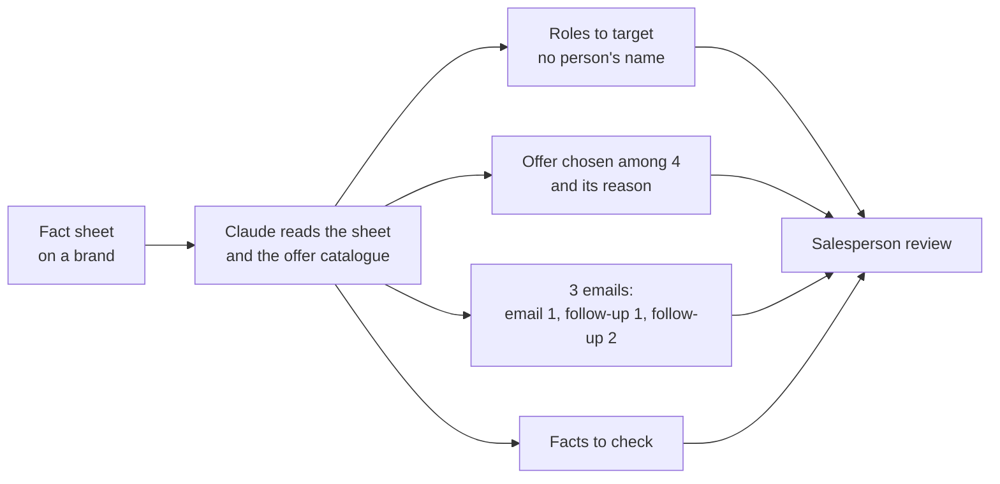

# Media-prospecting preparation assistant

Demonstration project: an assistant (n8n + Claude) that, from a sheet of facts about a brand, prepares a media salesperson's work: roles to target, offer to propose, three sequence emails and a list of facts to check. **A human reviews everything before sending; the assistant sends nothing.**

> **Everything is fictional.** The agency (Hexamédia), its four sites, its offers and the 40 brands are invented. No real data (prospect, contact, price, company figure) was used. The project is **designed from my own practice of prospecting** (3-step email sequences, targeting by sector) and **tested on synthetic data; it has never been used in production**, nor at any employer.
>
> **Language and measurement note.** This is the English edition of the project. The data, prompts and code were **translated** from the French original; the figures in this repository (results, error log, case study) were **measured on the French-language run** and have **not been re-measured** on the English translation. Translating can change a model's behaviour, so treat the English prompts and data as a faithful translation, not a re-validated version. The raw outputs in `evaluation/` and `baseline/` are the French run's (French emails, French headers).

## What the assistant does

- It uses only the facts on the sheet and flags a contradictory figure, a fact older than 2 years or missing information.
- It proposes **roles** (for example "marketing director"), never named people: finding contacts is out of scope.
- No price, no promised result, no legal alert (out of scope).

## Results

All figures are **measured** on synthetic sheets, in French. A single run per version (the model is not deterministic). Details and limits: [`evaluation/results_summary.md`](evaluation/results_summary.md).

| Measure | Result |
|---|---|
| Traps flagged (sheets with a contradictory figure, an old fact or missing info) | 12/12 on test, 10/10 on validation, for Haiku 5.5 and Sonnet 5.5 |
| No-AI baseline (single template) | 0 traps flagged, "marketing manager" for every brand |
| "Branded content" offer (diversity) | 88% with prompt v1, 53 to 62% with v2 |
| AI rating on 12 validation sheets (mean out of 4) | Haiku: accuracy 3.92, flagging 3.67, targeting 4.0, relevance 3.33, emails 3.75. Sonnet: 3.92 / 3.67 / 3.92 / 3.67 / 3.5 |
| Agreement between AI judge and blind human check (10 outputs) | 35 scores out of 50 identical (70%), 49 out of 50 within 1 point; the AI is stricter |
| Measured cost | Haiku 5.5 about $0.002 per sheet; Sonnet 5.5 about $0.030 per sheet (17 times more) |

**Recommendation: Haiku 5.5**, which showed no flaw that Sonnet avoids on this sample.

## What these results do not prove

- **Flagging is inflated**: the assistant puts alerts on almost every sheet, including those without a trap (empty list 1 time out of 18 for Haiku). Detecting every trap is therefore easy; knowing how to say "nothing to flag" is not achieved. Flaw documented, not fixed.
- The baseline is weak: the fair comparison would be with emails written by hand, not done.
- The 28 test sheets were used to correct the prompt; only validation (12 sheets) is unbiased.
- The AI judge is from the same model family as the models evaluated; the human check is a single evaluator, the author, on 10 outputs.
- No measure of real usefulness (reply rate, time saved). The Haiku / Sonnet comparison rests on very few cases.

## Repository contents

| Folder | Contents |
|---|---|
| [`docs/`](docs/) | [Scoping](docs/scoping.md) (scope, criteria fixed before the tests) and [case study](docs/case_study.md) |
| [`data/`](data/) | 40 synthetic brands (28 test, 12 validation), fictional agency, generation script, French originals |
| [`baseline/`](baseline/) | No-AI template and its outputs (French) |
| [`prompts/`](prompts/) | Prompt v1 and prompt v2 (frozen before validation), English translation |
| [`workflow/`](workflow/) | n8n node code (test sheets, validation sheets, reading of results), English translation |
| [`evaluation/`](evaluation/) | Outputs of each version (French run), grid, AI rating, blind human check, error log (18 entries), summary |

## Reproduce

1. In n8n, build the workflow: Code node "Demandes" ([`workflow/n8n_code_sheets_test.js`](workflow/n8n_code_sheets_test.js) or `_validation.js`) → Anthropic "Message a model" node (prompt from [`prompts/prompt_v2.txt`](prompts/prompt_v2.txt) followed by `BRAND SHEET` and `{{ $json.demande }}`, token limit 6000) → Code node "Lecture" ([`workflow/n8n_code_reading.js`](workflow/n8n_code_reading.js)).
2. Run, export to CSV, rate with [`evaluation/rating_grid.md`](evaluation/rating_grid.md).
3. The validation set must be run only once per version.
4. Results will differ from those published here: they were obtained in French, and a single run is not deterministic.

## Another project in this portfolio

[Support-request triage and draft-reply assistant](https://github.com/pxulng/assistant-support-client): same evaluation approach (no-AI baseline, validation set, two models compared, human check, error log) on a different use case.

## Author

Paul Nguyen Phuoc, [LinkedIn](https://www.linkedin.com/in/paul-nguyen-phuoc-336456294)
